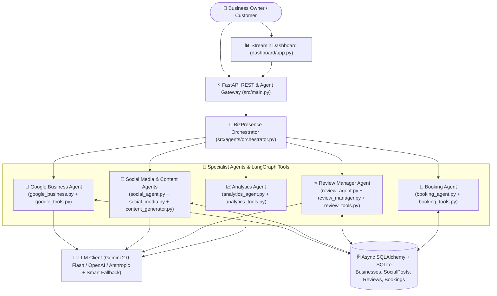

<div align="center">

# 🏪 BizPresence AI — Local Business Digital Presence Agent

[](https://www.python.org/downloads/)
[](https://fastapi.tiangolo.com/)
[](https://www.langchain.com/langgraph)
[](https://streamlit.io/)
[](./LICENSE)
[](./.github/workflows/ci.yml)

**Turn natural language into an always-on digital marketing & operations team for local businesses.**

[Quick Start](#-quick-start) • [Architecture](#-architecture) • [Agents](#-multi-agent-features) • [API Docs](#-api-documentation) • [Dashboard](#-streamlit-dashboard) • [Configuration](#-configuration)

</div>

---

## 📖 Overview

**BizPresence AI** is an AI-powered multi-agent system built to solve a real-world problem: local shops, restaurants, salons, and service providers lose customers to larger chains because they lack the time or technical staff to maintain an active digital presence.

Through a natural-language **Orchestrator Agent**, specialist **LangGraph ReAct & domain agents**, an async **FastAPI** backend with **SQLite/SQLAlchemy**, and a **Streamlit** dashboard, a non-technical business owner can manage their entire online footprint from one place:

- **Google Business Profile (GBP):** Setup, verification checklist, updates, hours, photos, Q&A, and insights
- **Social Media Marketing:** AI-generated posts, hashtags, optimal timing, and 14-day content calendar across Instagram, Facebook, Google Posts, and Twitter/X
- **Review & Reputation Management:** Automated sentiment classification, critical review flagging, and personalized AI replies (single or batch auto-respond)
- **Bookings & Availability:** Operating-hours-aware slot discovery, conflict prevention, and appointment management
- **Proactive AI Growth Suggestions:** Automatic audits of pending reviews, unverified profiles, empty content calendars, and open booking slots

---

## 🏗 Architecture



---

## ✨ Multi-Agent Features

| Agent | Module(s) | Capabilities |
| :--- | :--- | :--- |
| **Orchestrator** | `src/agents/orchestrator.py` | Intent routing, context loading, auto-execution of social/review actions, proactive suggestions |
| **Google Business** | `src/agents/google_business.py`, `src/tools/google_tools.py` | Profile updates, GBP local posts, business hours, photo management, Q&A, insights |
| **Social Media** | `src/agents/social_agent.py`, `src/agents/social_media.py`, `src/tools/social_tools.py` | Platform-tailored posts (IG/FB/X/GBP), hashtag generation, scheduling, optimal posting times |
| **Content Generator** | `src/agents/content_generator.py`, `src/tools/content_tools.py` | Multi-week content calendars, post ideas, seasonal offers, local blog outlines |
| **Review Manager** | `src/agents/review_agent.py`, `src/agents/review_manager.py`, `src/tools/review_tools.py` | Sentiment analysis, empathetic reply drafting, critical review flagging, trend tracking |
| **Booking Manager** | `src/agents/booking_agent.py`, `src/tools/booking_tools.py` | Operating-hours slot availability, double-booking conflict prevention, cancellations |
| **Analytics** | `src/agents/analytics_agent.py`, `src/tools/analytics_tools.py` | Cross-platform metrics aggregation, executive reports, trend detection |

> **Works Out of the Box:** When `GEMINI_API_KEY` (or `OPENAI_API_KEY` / `ANTHROPIC_API_KEY`) is configured, the LLM client generates dynamic copy and replies. Without an API key, deterministic domain-aware fallbacks keep every workflow functional for local testing and demos.

---

## 🛠 Tech Stack

| Layer | Technology |
| :--- | :--- |
| **Language** | Python 3.11+ |
| **Backend API** | FastAPI + Uvicorn |
| **Agent Framework** | LangChain + LangGraph (`create_react_agent` + `@tool`) |
| **LLM Providers** | Google Gemini 2.0 Flash (default), with optional OpenAI & Anthropic support |
| **Database & ORM** | Async SQLAlchemy + SQLite (`aiosqlite`) |
| **Frontend UI** | Streamlit + Pandas + Plotly |
| **Testing & QA** | Pytest, pytest-asyncio, pytest-cov, Ruff, GitHub Actions |
| **Containerization** | Docker & Docker Compose |

---

## 🚀 Quick Start

### 1. Clone the Repository

```bash
git clone https://github.com/chauhansachin13/local-biz-agent.git
cd local-biz-agent
```

### 2. Install Dependencies

```bash
python3 -m venv .venv
source .venv/bin/activate  # On Windows: .venv\Scripts\activate

pip install --upgrade pip
pip install -r requirements.txt
```

### 3. Configure Environment Variables

```bash
cp .env.example .env
# Edit .env and add your GEMINI_API_KEY (optional for offline/fallback testing)
```

### 4. Seed Sample Data (Optional)

Loads 2 realistic local businesses (*Bella Napoli Trattoria* & *Lumina Hair & Spa*), 10 reviews, 5 social posts, and 8 bookings:

```bash
python3 scripts/seed_data.py
```

### 5. Run the FastAPI Backend

```bash
python3 -m uvicorn src.main:app --reload --host 0.0.0.0 --port 8000
```

- **Swagger UI:** `http://localhost:8000/docs`
- **ReDoc:** `http://localhost:8000/redoc`

### 6. Launch the Streamlit Dashboard

In a second terminal:

```bash
streamlit run dashboard/app.py --server.port 8501
```

Open **`http://localhost:8501`** in your browser.

### 🐳 Run with Docker Compose

```bash
cp .env.example .env
docker compose up --build
```

### 🧪 Run Tests & Linting

```bash
pip install -e ".[dev]"
ruff check .
ruff format --check .
pytest -v --cov=src --cov-report=term-missing
```

---

## 📡 API Documentation

| Method | Endpoint | Description |
| :--- | :--- | :--- |
| `GET` | `/` | API metadata and endpoint index |
| `GET` | `/health` | Service and database health check |
| `POST` | `/api/businesses/` | Register a new local business |
| `GET` | `/api/businesses/` | List all registered businesses |
| `GET` | `/api/businesses/{business_id}` | Get business profile details |
| `PUT` | `/api/businesses/{business_id}` | Update business profile and hours |
| `POST` | `/api/businesses/{business_id}/setup-google` | Configure & verify Google Business Profile |
| `GET` | `/api/businesses/{business_id}/dashboard` | Dashboard metrics & recent activity feed |
| `POST` | `/api/social/{business_id}/post` | Publish or save a draft social post |
| `POST` | `/api/social/{business_id}/schedule` | Schedule a social media post |
| `GET` | `/api/social/{business_id}/posts` | List social posts (filter by platform/status) |
| `GET` | `/api/social/{business_id}/calendar` | Multi-day content calendar view |
| `POST` | `/api/social/{business_id}/generate-content` | AI-generate platform-specific post copy & hashtags |
| `GET` | `/api/reviews/{business_id}/reviews` | List reviews (filter by sentiment/status/platform) |
| `POST` | `/api/reviews/{business_id}/reviews/{review_id}/respond` | Post custom or AI-drafted reply |
| `POST` | `/api/reviews/{business_id}/reviews/auto-respond` | Batch AI auto-respond to pending reviews |
| `GET` | `/api/reviews/{business_id}/reviews/analytics` | Sentiment breakdown, rating distribution & trends |
| `POST` | `/api/bookings/{business_id}/book` | Create booking with slot-conflict validation |
| `GET` | `/api/bookings/{business_id}/bookings` | List bookings (filter by status/date range) |
| `PUT` | `/api/bookings/{business_id}/bookings/{booking_id}` | Update/reschedule booking |
| `DELETE` | `/api/bookings/{business_id}/bookings/{booking_id}` | Cancel a booking |
| `GET` | `/api/bookings/{business_id}/availability` | Check open appointment slots for a date |
| `POST` | `/api/agent/{business_id}/chat` | Send a natural-language prompt to the Orchestrator |
| `GET` | `/api/agent/{business_id}/suggestions` | Get prioritized proactive AI recommendations |

### Example: Chatting with the Orchestrator

```bash
curl -X POST "http://localhost:8000/api/agent/1/chat" \
  -H "Content-Type: application/json" \
  -d '{
    "message": "Create an Instagram post about our weekend special",
    "auto_execute": true
  }'
```

---

## 📊 Streamlit Dashboard

The Streamlit UI (`dashboard/app.py`) includes 6 integrated workspaces:

1. **Dashboard Overview:** KPIs (total reviews, avg rating, posts this week, upcoming bookings), recent activity feed, and one-click AI priority actions.
2. **Social Media Studio:** Post composer with AI Assist, live preview, 14-day content calendar, and post history with engagement metrics.
3. **Reviews Hub:** Sentiment-tagged feed, one-click AI replies, batch Auto-Respond, and Plotly sentiment/rating analytics.
4. **Bookings Manager:** Daily/weekly metrics, booking schedule with cancellation, new booking form, and slot availability grid.
5. **AI Assistant:** Conversational chat with quick prompts and optional auto-execution toggle.
6. **Settings:** Profile editor, Google Business Profile verification wizard, session-scoped API keys, and new business onboarding.

---

## 📁 Project Structure

```text
local-biz-agent/
├── .github/workflows/ci.yml       # GitHub Actions CI (Ruff + Pytest)
├── config/
│   └── settings.py                # Pydantic settings loaded from .env
├── dashboard/
│   └── app.py                     # Multi-page Streamlit command center
├── scripts/
│   └── seed_data.py               # Database seeder (2 businesses, reviews, posts, bookings)
├── src/
│   ├── main.py                    # FastAPI app, lifespan & exception handlers
│   ├── database/db.py             # Async SQLAlchemy engine, session & Base
│   ├── models/                    # ORM models & Pydantic schemas
│   ├── agents/                    # Orchestrator + LangGraph & domain agents
│   ├── tools/                     # LangChain @tool modules (GBP, social, review, content, booking, analytics)
│   ├── api/                       # FastAPI routers
│   └── utils/                     # Structured colored logger & helpers
├── tests/
│   ├── conftest.py                # Async SQLite & HTTPX test fixtures
│   ├── test_agents.py             # Agent, orchestrator, tool & helper unit tests
│   └── test_api.py                # FastAPI endpoint integration tests
├── Dockerfile                     # Multi-stage container build
├── docker-compose.yml             # API + Streamlit services
├── pyproject.toml                 # Ruff & Pytest configuration
├── requirements.txt               # Python dependencies
├── setup.py                       # Package configuration
└── LICENSE                        # MIT License
```

---

## ⚙️ Configuration

| Variable | Default | Description |
| :--- | :--- | :--- |
| `GEMINI_API_KEY` | `""` | Google Gemini API key for AI agents |
| `OPENAI_API_KEY` | `""` | Optional OpenAI fallback key |
| `ANTHROPIC_API_KEY` | `""` | Optional Anthropic fallback key |
| `DATABASE_URL` | `sqlite:///./bizpresence.db` | SQLAlchemy database connection URL |
| `API_BASE_URL` | `http://localhost:8000` | Backend URL used by Streamlit dashboard |
| `GOOGLE_BUSINESS_ACCOUNT_ID` | `""` | Google Business Profile account ID |
| `GOOGLE_BUSINESS_LOCATION_ID` | `""` | Google Business Profile location ID |
| `FACEBOOK_PAGE_TOKEN` | `""` | Facebook Graph API page token |
| `INSTAGRAM_ACCESS_TOKEN` | `""` | Instagram Graph API access token |
| `TWITTER_API_KEY` | `""` | Twitter/X API key |
| `LOG_LEVEL` | `INFO` | Logging verbosity (`DEBUG`, `INFO`, `WARNING`, `ERROR`) |

---

## 📄 License

Licensed under the **MIT License** — see [LICENSE](./LICENSE).

---

## 👨‍💻 Author

**Sachin Chauhan** ([@chauhansachin13](https://github.com/chauhansachin13))
