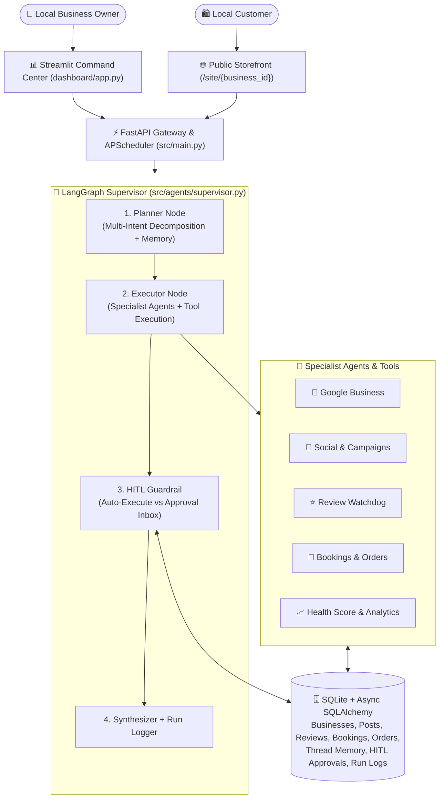

<div align="center">

# 🏪 BizPresence AI — Local Business Digital Presence Agent

[](https://www.python.org/downloads/)
[](https://fastapi.tiangolo.com/)
[](https://www.langchain.com/langgraph)
[](https://streamlit.io/)
[](./LICENSE)
[](./.github/workflows/ci.yml)

**A full multi-agent Agentic AI platform that gives any local shop, restaurant, or salon an autonomous digital presence team—plus a zero-tech dashboard and shareable customer storefront.**

[Quick Start](#-quick-start) • [Agentic AI Features](#-agentic-ai-capabilities) • [Architecture](#-architecture) • [API Docs](#-api-documentation) • [Dashboard](#-streamlit-dashboard)

</div>

---

## 📖 Overview

Local shops, restaurants, salons, and neighborhood service providers often lose customers to large chains simply because they lack a tech team to set up Google Business Profiles, reply to customer reviews, publish consistent social content, or accept online bookings and orders.

**BizPresence AI** solves this end-to-end with a complete **LangGraph Multi-Agent System**:
- **60-Second Digital Launch Wizard:** Enter shop name, category, city, and phone → AI builds an SEO bio, Google Business checklist, catalog/menu, and 3 starter social posts in one click.
- **LangGraph Multi-Agent Supervisor + Quality Critic:** Decomposes compound natural-language commands into ordered tasks, executes SQLite-backed specialist agents & tools, and runs a **Self-Reflection Quality Critic** (`critic_node`) to enforce character limits, brand tone, and empathetic customer care.
- **Persistent Conversational Memory:** Remembers prior turns per business session in SQLite (`AgentThreadMessage`).
- **Human-in-the-Loop (HITL) Safety Guardrails:** High-risk actions (such as ≤2★ negative review replies) or Copilot drafts are queued in an **Approval Inbox** so owners can review, edit, approve, or reject with one click.
- **Autonomous APScheduler Autopilot:** Background worker automatically publishes due scheduled posts and triages new pending reviews every 5 minutes (or on-demand).
- **WhatsApp Business Concierge:** Handles inbound WhatsApp messages from customers (hours, open slots, instant bookings, pickup/delivery orders) and owner commands.
- **Branded Promo Graphics & Scannable QR Posters:** Generates 1080×1080 Pillow PNG promo cards with embedded QR codes plus print-ready counter QR flyers (`/site/{id}/poster`).
- **Digital Presence Health Score (0–100) & Morning Brief:** Scores 5 pillars, runs local SEO & review theme audits, and produces a daily executive brief.
- **Instant Customer Storefront (`/site/{business_id}`):** Mobile-friendly public web page where customers can browse services/menu, book appointments, place online pickup/delivery orders, and submit reviews—plus `.ics` calendar export.
- **Multi-Language Support:** Generate posts and review replies in English, Hindi, Hinglish, Spanish, or French.
- **Multi-Agent Strategy Council & Festival Planner:** 3 specialist agents (Growth, Reputation, Operations) debate metrics to synthesize a consensus weekly plan + seasonal promo calendar.
- **Customer CRM, Loyalty & Competitor Watch:** Auto-builds unified VIP/Regular/New profiles, queues personalized retention offers, tracks nearby competitors, and recommends counter-strategies.
- **A/B Social Variants, Voice Commands & CSV Exports:** Compares Storytelling vs Offer variants, supports voice transcripts, and exports Bookings/Orders/Reviews/CRM CSVs.
- **Standalone Web App (`/app`) & Multi-Cloud Deploy:** Deployable to **GitHub Pages**, **Netlify** (`netlify.toml`), **Render** (`render.yaml`), **Railway/Heroku** (`Procfile`), or **Docker**.

---

## 🧠 Agentic AI Capabilities

| Capability | How It Works | Module |
| :--- | :--- | :--- |
| **LangGraph Supervisor** | `StateGraph` (`planner → executor → synthesizer`) decomposes compound prompts and orchestrates specialist agents | `src/agents/supervisor.py` |
| **Persistent Thread Memory** | Stores conversation history + per-message agent traces per `session_id` | `src/models/agent_models.py` |
| **Human-in-the-Loop (HITL)** | Queues sensitive replies / Copilot posts in Approval Inbox for 1-click Edit, Approve & Execute, or Reject | `src/agents/supervisor.py` |
| **Autonomous Background Autopilot** | `APScheduler` job publishes due posts and triages reviews every 5 mins + writes audit logs | `src/agents/scheduler.py` |
| **Agent Observability Logs** | Records every trigger, agents invoked, tools called, step trace, and latency (`ms`) | `AgentRunLog` |
| **60-Sec Launchpad & Campaigns** | Multi-agent onboarding + 1-click multi-platform promotional campaign generator | `src/agents/health_and_growth.py` |
| **Specialist Agents & Tools** | Google Business, Social Media, Content, Reviews, Bookings, Orders, and Analytics `@tool` suites | `src/agents/*.py`, `src/tools/*.py` |

> **Works Out of the Box:** With `GEMINI_API_KEY` (or `OPENAI_API_KEY` / `ANTHROPIC_API_KEY`), agents run dynamic LLM planning and generation. Without an API key, deterministic multi-step planning and domain-aware fallbacks keep every workflow operational for offline demos and testing.

---

## 🏗 Architecture



---

## 🛠 Tech Stack

| Layer | Technology |
| :--- | :--- |
| **Language** | Python 3.11+ |
| **Backend & Microsite** | FastAPI + Uvicorn |
| **Agent Orchestration** | LangGraph (`StateGraph` + `create_react_agent`) & LangChain `@tool` |
| **Autopilot Scheduler** | APScheduler (`AsyncIOScheduler`) |
| **LLM Providers** | Google Gemini 2.0 Flash (default), optional OpenAI & Anthropic + smart fallback |
| **Database & ORM** | Async SQLAlchemy + SQLite (`aiosqlite`) |
| **Frontend UI** | Streamlit + Pandas + Plotly |
| **Testing & CI** | Pytest, pytest-asyncio, pytest-cov, Ruff, GitHub Actions |

---

## 🚀 Quick Start

```bash
git clone https://github.com/chauhansachin13/local-biz-agent.git
cd local-biz-agent

python3 -m venv .venv
source .venv/bin/activate  # On Windows: .venv\Scripts\activate
pip install --upgrade pip && pip install -r requirements.txt

cp .env.example .env       # Optional: add GEMINI_API_KEY
python3 scripts/seed_data.py
```

Run backend & dashboard in two terminals:

```bash
# Terminal 1: FastAPI API + Public Storefront + Autopilot Scheduler
python3 -m uvicorn src.main:app --reload --host 0.0.0.0 --port 8000

# Terminal 2: Streamlit Command Center
streamlit run dashboard/app.py --server.port 8501
```

- **Web App UI:** `http://localhost:8000/app`
- **Streamlit Dashboard:** `http://localhost:8501`
- **API Docs (Swagger):** `http://localhost:8000/docs`
- **Sample Public Storefront:** `http://localhost:8000/site/1`

### 🌐 Deploy Online (GitHub Pages, Netlify & Render)

| Platform | Target | Config |
| :--- | :--- | :--- |
| **GitHub Pages** | Live Web App (`web/`) with Sandbox + Live API connector | [.github/workflows/pages.yml](./.github/workflows/pages.yml) |
| **Netlify** | Web App + Edge Functions + `/api/*` & `/site/*` proxy | [netlify.toml](./netlify.toml), [netlify/functions/health.mjs](./netlify/functions/health.mjs) |
| **Render / Railway** | Full FastAPI Backend + Storefront + APScheduler | [render.yaml](./render.yaml), [Procfile](./Procfile) |

### 🐳 Docker Compose

```bash
cp .env.example .env
docker compose up --build
```

### 🧪 Run Tests & Linting

```bash
pip install -e ".[dev]"
ruff check .
ruff format --check .
pytest -v --cov=src --cov-report=term-missing
```

---

## 📡 API Documentation

| Category | Endpoints |
| :--- | :--- |
| **Health & Root** | `GET /`, `GET /health` |
| **Businesses & GBP** | `POST /api/businesses/`, `GET /api/businesses/`, `GET /api/businesses/{id}`, `PUT /api/businesses/{id}`, `POST /api/businesses/{id}/setup-google`, `GET /api/businesses/{id}/dashboard` |
| **Social & Content** | `POST /api/social/{id}/post`, `POST /api/social/{id}/schedule`, `GET /api/social/{id}/posts`, `GET /api/social/{id}/calendar`, `POST /api/social/{id}/generate-content` |
| **Reviews** | `GET /api/reviews/{id}/reviews`, `POST /api/reviews/{id}/reviews/{rid}/respond`, `POST /api/reviews/{id}/reviews/auto-respond`, `GET /api/reviews/{id}/reviews/analytics` |
| **Bookings** | `POST /api/bookings/{id}/book`, `GET /api/bookings/{id}/bookings`, `PUT /api/bookings/{id}/bookings/{bid}`, `DELETE /api/bookings/{id}/bookings/{bid}`, `GET /api/bookings/{id}/availability` |
| **Online Orders** | `POST /api/orders/{id}/order`, `GET /api/orders/{id}/orders`, `PUT /api/orders/{id}/orders/{oid}` |
| **Customer Storefront** | `GET /site/{business_id}` (live mobile-friendly booking & ordering web page) |
| **Agentic AI & HITL** | `POST /api/agent/magic-onboard`, `POST /api/agent/{id}/chat`, `GET/DELETE /api/agent/{id}/history`, `GET /api/agent/{id}/health-score`, `GET /api/agent/{id}/suggestions`, `GET /api/agent/{id}/approvals`, `POST /api/agent/{id}/approvals/{aid}/decide`, `GET /api/agent/{id}/logs`, `GET/PUT /api/agent/{id}/autopilot`, `POST /api/agent/{id}/autopilot/run`, `POST /api/agent/{id}/campaign` |

---

## 📊 Streamlit Dashboard Workspaces

1. **🏠 Home & Health Score:** 0–100 presence health score across 5 pillars, live KPIs, shareable customer link, activity feed, and 1-click AI priority fixes.
2. **✨ 60-Sec Launch Wizard:** Zero-tech onboarding form that launches a complete business profile, catalog, GBP verification, and starter posts automatically.
3. **🤖 AI Autopilot & Approvals:** Human-in-the-Loop Inbox (edit/approve/reject drafts), autopilot guardrail toggles, manual autopilot trigger, and full agent execution logs.
4. **💬 AI Command Chat:** Multi-turn persistent chat with multi-step LangGraph planning, language selector, Copilot/Autopilot toggle, and expandable tool traces.
5. **📣 Social & Campaigns:** Single post composer with AI Assist, **1-Click Multi-Channel Campaign Launcher**, 14-day content calendar, and post analytics.
6. **⭐ Reviews:** Sentiment feed, 1-click AI reply, batch auto-responder, and Plotly charts.
7. **📅 Bookings & Orders:** Appointment schedule, slot availability grid, new booking form, and live online orders fulfillment queue.
8. **🌐 Customer Storefront:** Shareable storefront link + point-and-click catalog/menu editor.
9. **⚙️ Settings:** Profile editor, Google Business setup checklist, and session API key configuration.

---

## 📄 License & Author

Licensed under the **MIT License** — see [LICENSE](./LICENSE).  
Built by **Sachin Chauhan** ([@chauhansachin13](https://github.com/chauhansachin13)).
