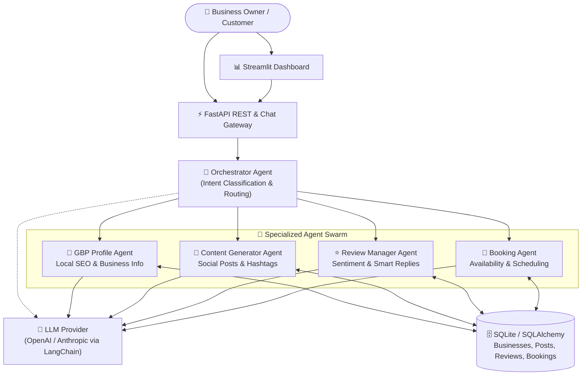

<div align="center">

# 🏪 BizPresence AI — Local Business Digital Presence Agent

[](https://www.python.org/downloads/)
[](https://fastapi.tiangolo.com/)
[](https://www.langchain.com/)
[](https://streamlit.io/)
[](./LICENSE)
[](./.github/workflows/ci.yml)

**Turn natural language into an always-on digital marketing & operations team for local businesses.**

[Quick Start](#-quick-start) • [Architecture](#-architecture) • [Agents](#-multi-agent-features) • [API Docs](#-api-documentation) • [Dashboard](#-streamlit-dashboard) • [Configuration](#-configuration)

</div>

---

## 📖 Overview

An AI-powered multi-agent system that helps local businesses build and manage their digital presence — from Google Business profiles to social media, reviews, and bookings — all through natural language.

Local business owners rarely have the time or specialized staff to optimize local SEO, write consistent social posts, reply thoughtfully to customer reviews, and coordinate appointment slots. **BizPresence AI** unifies these workflows behind an intelligent **Orchestrator Agent** that classifies intent, maintains business context, and delegates tasks to domain-specialized agents backed by a FastAPI service, persistent SQLite/SQLAlchemy storage, and an interactive Streamlit command center.

---

## 🏗 Architecture

BizPresence AI uses a supervisor-worker multi-agent architecture. Incoming natural-language requests pass through the FastAPI gateway to the **Orchestrator Agent**, which classifies user intent, injects business profile context, and routes execution to the right specialist agent.



---

## ✨ Multi-Agent Features

### 🧠 Orchestrator Agent (`OrchestratorAgent`)
- **Intent Classification:** Analyzes conversational prompts to identify whether the user wants profile updates, social content, review responses, or booking management.
- **Context Injection:** Automatically loads the target business's tone, category, hours, and location from the database before delegating.
- **Graceful Fallback:** Handles general digital-presence questions or ambiguous queries directly with clarifying follow-ups.

### 📍 Google Business Profile Agent (`ProfileAgent`)
- **Local SEO Optimization:** Rewrites business descriptions with high-intent local keywords while keeping brand voice authentic.
- **Profile Completeness Audits:** Checks missing attributes (business hours, service categories, contact details, Q&A) and suggests improvements.
- **Structured Updates:** Applies verified changes to business hours, descriptions, and attributes via API tools.

### 📣 Content Generator Agent (`ContentAgent`)
- **Multi-Platform Copywriting:** Crafts tailored posts for **Instagram**, **Facebook**, **Google Business Posts**, and **LinkedIn**.
- **Campaign & Promo Ideation:** Generates seasonal promos, product spotlights, and event announcements with curated hashtags and calls-to-action (CTAs).
- **Scheduling Ready:** Saves draft or scheduled posts directly to the content calendar database.

### ⭐ Review Manager Agent (`ReviewAgent`)
- **Sentiment & Urgency Scoring:** Automatically classifies incoming customer reviews (`positive`, `neutral`, `negative`) and flags urgent complaints.
- **Brand-Aligned Reply Drafting:** Produces empathetic, personalized responses tailored to the customer's feedback and rating.
- **Reputation Insights:** Summarizes recurring praise and pain points across historical reviews.

### 📅 Booking & Scheduling Agent (`BookingAgent`)
- **Real-Time Availability Checks:** Inspects existing appointments and business operating hours to return open time slots.
- **Conflict Prevention:** Validates requested slots before booking to prevent double-bookings or out-of-hours scheduling.
- **Natural-Language Reservations:** Books, reschedules, or cancels appointments directly from conversational requests.

---

## 📸 Screenshots

> _Add your application screenshots to `docs/screenshots/` to showcase the live UI._

| Command Center & Analytics | Natural Language Agent Chat |
| :---: | :---: |
|  |  |
| *Business health score, recent bookings, and review sentiment metrics* | *Chat directly with the Orchestrator to run any workflow* |

| Social Media Content Studio | Review Inbox & AI Responder |
| :---: | :---: |
|  |  |
| *Generate, preview, and schedule multi-platform social posts* | *Analyze sentiment and publish AI-drafted customer replies* |

---

## 🛠 Tech Stack

| Layer | Technology | Purpose |
| :--- | :--- | :--- |
| **Language** | [Python 3.11+](https://www.python.org/) | Core runtime with modern type hints and async support |
| **Backend API** | [FastAPI](https://fastapi.tiangolo.com/) + [Uvicorn](https://www.uvicorn.org/) | High-performance REST & agent chat endpoints with OpenAPI docs |
| **Agent Orchestration** | [LangChain](https://www.langchain.com/) | Prompt templates, structured outputs, tool calling, and LLM routing |
| **LLM Providers** | [OpenAI](https://platform.openai.com/) / [Anthropic](https://www.anthropic.com/) | Foundation models for reasoning, copywriting, and sentiment analysis |
| **Database & ORM** | [SQLAlchemy](https://www.sqlalchemy.org/) + SQLite | Persistent storage for businesses, posts, reviews, and bookings |
| **Validation** | [Pydantic v2](https://docs.pydantic.dev/) | Strict request/response schemas and environment configuration |
| **Frontend UI** | [Streamlit](https://streamlit.io/) | Interactive business command center and chat interface |
| **Testing & QA** | [Pytest](https://docs.pytest.org/) + [Ruff](https://docs.astral.sh/ruff/) | Automated unit/integration testing, coverage, and fast linting |
| **CI/CD** | [GitHub Actions](https://github.com/features/actions) | Automated linting and test suite execution on every push and PR |

---

## 🚀 Quick Start

### 1. Clone the Repository

```bash
git clone https://github.com/sachinchauhan/local-biz-agent.git
cd local-biz-agent
```

### 2. Create a Virtual Environment & Install Dependencies

```bash
python3.11 -m venv .venv
source .venv/bin/activate  # On Windows: .venv\Scripts\activate

pip install --upgrade pip
pip install -e ".[dev]"
# Or, if using requirements.txt:
# pip install -r requirements.txt
```

### 3. Configure Environment Variables

Create a `.env` file in the project root:

```bash
cp .env.example .env
```

Edit `.env` and add your API key (see [Configuration](#-configuration) for all options):

```env
OPENAI_API_KEY=sk-your-openai-api-key
LLM_MODEL=gpt-4o-mini
DATABASE_URL=sqlite:///./bizpresence.db
ENVIRONMENT=development
```

### 4. Run the FastAPI Backend

```bash
uvicorn app.main:app --reload --host 0.0.0.0 --port 8000
```

Interactive API documentation will be available at:
- **Swagger UI:** `http://localhost:8000/docs`
- **ReDoc:** `http://localhost:8000/redoc`

### 5. Launch the Streamlit Dashboard

In a second terminal (with `.venv` activated):

```bash
streamlit run dashboard/app.py --server.port 8501
```

Open **`http://localhost:8501`** in your browser to access the BizPresence AI Dashboard.

### 6. Run the Test Suite

```bash
pytest --cov=app --cov-report=term-missing
```

---

## 📡 API Documentation

All API endpoints are versioned under `/api/v1` (except health checks). Full interactive schemas are auto-generated by FastAPI at `/docs`.

| Method | Endpoint | Description |
| :--- | :--- | :--- |
| `GET` | `/health` | Service health check and database/environment status |
| `POST` | `/api/v1/businesses` | Register a new local business profile |
| `GET` | `/api/v1/businesses` | List all registered businesses |
| `GET` | `/api/v1/businesses/{business_id}` | Retrieve details for a specific business |
| `PATCH` | `/api/v1/businesses/{business_id}` | Update business profile, hours, or SEO description |
| `POST` | `/api/v1/posts` | Create or AI-generate a social media post |
| `GET` | `/api/v1/posts` | List social posts (filterable by `business_id` and `platform`) |
| `POST` | `/api/v1/reviews` | Ingest a customer review and run sentiment analysis |
| `GET` | `/api/v1/reviews` | List reviews for a business with sentiment metadata |
| `POST` | `/api/v1/reviews/{review_id}/reply` | Generate or publish an AI-drafted reply to a review |
| `POST` | `/api/v1/bookings` | Create a new appointment booking with conflict validation |
| `GET` | `/api/v1/bookings` | List bookings or check available slots for a date |
| `POST` | `/api/v1/agent/chat` | Send a natural-language prompt to the Orchestrator Agent |

### Example: Chatting with the Orchestrator Agent

```bash
curl -X POST "http://localhost:8000/api/v1/agent/chat" \
  -H "Content-Type: application/json" \
  -d '{
    "business_id": 1,
    "message": "Write an Instagram post promoting our weekend sourdough special with 5 hashtags."
  }'
```

**Sample Response:**

```json
{
  "routed_agent": "content_agent",
  "intent": "create_social_post",
  "reply": "Fresh out of the oven this Saturday! 🥖✨ Stop by Sunrise Artisan Bakery for our warm rosemary sea-salt sourdough loaves...",
  "metadata": {
    "platform": "instagram",
    "hashtags": ["#Sourdough", "#ArtisanBakery", "#ShopLocal", "#WeekendSpecial", "#FreshBaked"]
  }
}
```

---

## 📊 Streamlit Dashboard

The Streamlit UI (`dashboard/app.py`) provides an intuitive workspace for non-technical business owners:

1. **🏠 Business Overview:** Select or onboard a local business, view digital presence KPIs (average rating, pending reviews, scheduled posts, upcoming bookings), and audit profile completeness.
2. **💬 AI Command Chat:** Conversational assistant powered by `POST /api/v1/agent/chat`. Ask anything in plain English—*"Check my bookings for Friday afternoon"* or *"Reply to Sarah's 3-star review"*—and inspect which specialist agent handled the request.
3. **📣 Social Media Studio:** Pick a platform (`Instagram`, `Facebook`, `Google Post`, `LinkedIn`), choose a tone, generate campaign copy with hashtags, and manage your post queue.
4. **⭐ Review & Reputation Hub:** Filter reviews by sentiment (`positive`, `neutral`, `negative`), view automated sentiment scores, and generate/approve replies in one click.
5. **📅 Booking Manager:** View upcoming customer appointments, inspect daily slot availability, and create or cancel bookings.

---

## 📁 Project Structure

```text
local-biz-agent/
├── .github/
│   └── workflows/
│       └── ci.yml                 # GitHub Actions CI (Ruff lint + Pytest coverage)
├── app/
│   ├── __init__.py
│   ├── main.py                    # FastAPI application entrypoint & middleware
│   ├── config.py                  # Pydantic settings & environment configuration
│   ├── database.py                # SQLAlchemy engine, session, and Base setup
│   ├── models.py                  # ORM models (Business, SocialPost, Review, Booking)
│   ├── schemas.py                 # Pydantic v2 request & response schemas
│   ├── agents/
│   │   ├── __init__.py
│   │   ├── orchestrator.py        # Intent classification & multi-agent router
│   │   ├── profile_agent.py       # Google Business Profile & local SEO agent
│   │   ├── content_agent.py       # Social media post & campaign generator
│   │   ├── review_agent.py        # Sentiment analysis & smart review responder
│   │   └── booking_agent.py       # Availability lookup & appointment booking
│   └── routers/
│       ├── __init__.py
│       ├── businesses.py          # Business CRUD endpoints
│       ├── posts.py               # Social post endpoints
│       ├── reviews.py             # Review ingestion & reply endpoints
│       ├── bookings.py            # Booking & slot availability endpoints
│       └── agent.py               # Natural-language /agent/chat endpoint
├── dashboard/
│   ├── __init__.py
│   └── app.py                     # Streamlit multi-tab business dashboard
├── docs/
│   └── screenshots/               # UI screenshots for documentation
├── tests/
│   ├── __init__.py
│   ├── conftest.py                # Pytest fixtures (test_db, test_client, sample data)
│   ├── test_agents.py             # Unit tests for Orchestrator & specialist agents
│   └── test_api.py                # FastAPI endpoint integration tests
├── .env.example                   # Sample environment variable template
├── LICENSE                        # MIT License
├── README.md                      # Project documentation
└── setup.py                       # Python package & CLI entry-point configuration
```

---

## ⚙️ Configuration

BizPresence AI is configured via environment variables (loaded automatically from `.env` via `pydantic-settings`).

| Variable | Default | Description |
| :--- | :--- | :--- |
| `OPENAI_API_KEY` | `""` | OpenAI API key used by LangChain LLM agents |
| `ANTHROPIC_API_KEY` | `""` | Optional Anthropic API key if using Claude models |
| `LLM_PROVIDER` | `"openai"` | Active LLM backend (`openai` or `anthropic`) |
| `LLM_MODEL` | `"gpt-4o-mini"` | Model identifier passed to the LangChain chat client |
| `LLM_TEMPERATURE` | `0.4` | Sampling temperature (`0.0` deterministic, `1.0` creative) |
| `DATABASE_URL` | `"sqlite:///./bizpresence.db"` | SQLAlchemy connection string (SQLite or PostgreSQL) |
| `API_HOST` | `"0.0.0.0"` | Host interface bound by Uvicorn |
| `API_PORT` | `8000` | Port exposed by the FastAPI backend |
| `API_BASE_URL` | `"http://localhost:8000"` | Backend URL consumed by the Streamlit dashboard |
| `STREAMLIT_PORT` | `8501` | Port exposed by the Streamlit frontend |
| `LOG_LEVEL` | `"INFO"` | Application logging verbosity (`DEBUG`, `INFO`, `WARNING`, `ERROR`) |
| `ENVIRONMENT` | `"development"` | Runtime environment (`development`, `staging`, `production`) |
| `CORS_ORIGINS` | `"http://localhost:8501"` | Comma-separated list of allowed CORS origins |

---

## 🤝 Contributing

Contributions are welcome and appreciated! To contribute:

1. **Fork** the repository and create a feature branch:
   ```bash
   git checkout -b feat/your-feature-name
   ```
2. **Install development dependencies:**
   ```bash
   pip install -e ".[dev]"
   ```
3. **Make your changes** following the existing architecture and type annotations.
4. **Run linting and tests locally** before committing:
   ```bash
   ruff check .
   ruff format --check .
   pytest --cov=app --cov-report=term-missing
   ```
5. **Open a Pull Request** describing your changes, motivation, and test coverage.

---

## 📄 License

This project is licensed under the **MIT License** — see the [LICENSE](./LICENSE) file for full details.

---

## 👨‍💻 Author

**Sachin Chauhan**
- Built with ❤️ using Python, FastAPI, LangChain, and Streamlit.
- If you find **BizPresence AI** helpful, consider giving the repository a ⭐!
